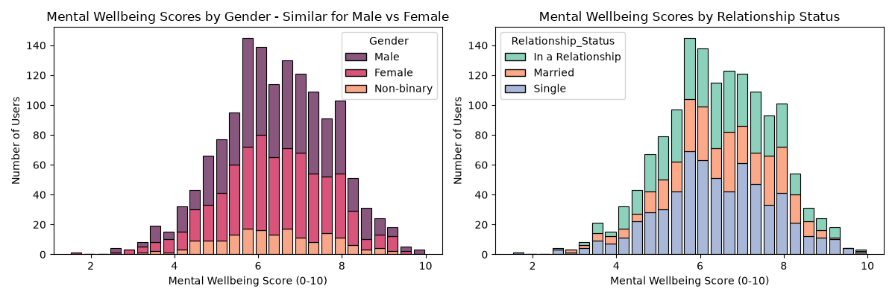
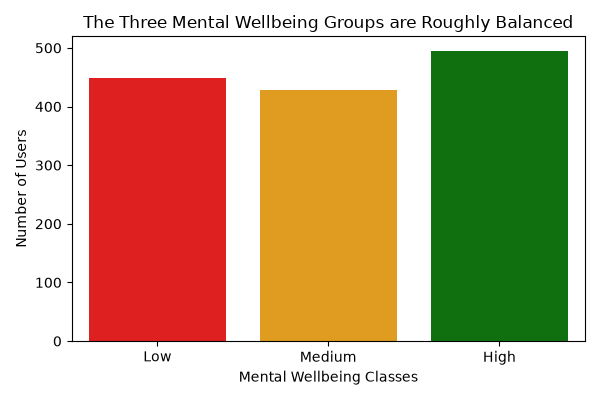
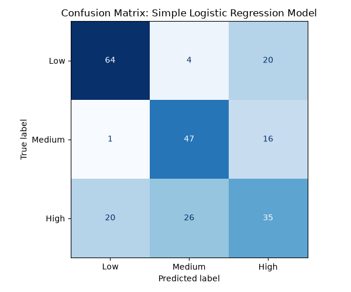
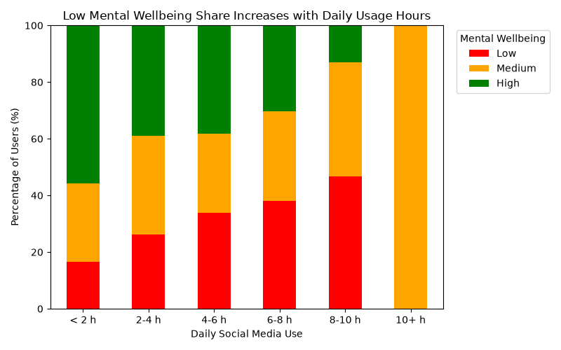

## Capstone Project: Initial Report and EDA

Link to [the notebook](https://github.com/vincentmui/Assignment20.1/blob/main/Capstone_Assignment_20_1_EDA.ipynb)

### Executive Summary

**Research Question** 

Is social media usage related to a user’s mental wellbeing? For example, are the number of hours spent daily on social media platforms related to the mental wellbeing score?

**Data Source** 

User data (e.g., age, gender, relationship status) and social media usage data (e.g., social media platform used, daily usage hours, time of use), and some mental wellbeing classification (e.g., wellbeing at risk?). A synthetic Kaggle dataset will be used: [Social Media Addiction & Mental Wellbeing Dataset](https://www.kaggle.com/datasets/harpartapsingh13/social-media-addiction-and-mental-wellbeing-dataset)

**Methodology** 

This project will follow the CRISP-DM framework. A subset of critical features will be selected and go through feature engineering. Different models will be applied: logistic regression, decision trees, KNN, random forests, and maybe Support Vector Machine (SVM with linear / Gaussian kernels). Grid search CV will be used to fine-tune hyper parameters, and error metrics will be used to select the best model.

**Expected Results**

The Machine Learning model should be able to tell what factors of social media usage (e.g., number of hours spent, age, night use) are related to a user’s mental wellbeing.

**Why This Question is Important** 

Understanding such factors will help business as well as public institutions:
- Businesses (markerters and advertisers) will understand how to effectively and responsibly use social media channels to advertise to their target audiences, with their mental wellbeing in mind.  E.g., reach target audience without negatively affecting their mental wellbeing.
- Public institutions can use the results to establish policies and guidelines for social media usage, to maintain good mental wellbeing of the general public. E.g., Parents/Social Media platforms may limit the hours spent on social media based on age group or time of use.  

---

### Business Understanding

From a business perspective, we are tasked with identifying key factors related to a social media user’s mental wellbeing;
- User's demographics (e.g., age, gender, relationship status, etc.)
- User's social media usage (e.g., number of hours spent, night use, trys to cut down usage, etc.)

#### Data Tasks
The business task can be reframed as the following data tasks:
- Is there one factor e.g., daily social usage hours (the independent variable) that is good for predicting the user's mental wellbeing (the dependent, outcome variable)?
- Which factors or variables (age, number of social platforms, night use, etc.) are the best predictors of the outcome variable (mental wellbeing)?
- How much do these independent variable(s) influence the outcome variable (mental wellbeing)? Can we use an algorithm to model the data to determine the magnitude and sign of such influences?

### Success Criteria
- Independent variable(s) identified for predicting user's mental wellbeing
- A machine learning model successfully selected to fit the data to determine the madnitude and sign of independent variables' influence. (based on objective criteria such as model scores/metrics)
- Business receommendations to businesses and institutions based on the data analysis and selected machine learning model

### Data Understanding - Exploratory Data Analysis

#### Data Description

Here are the column descriptions for *business* data understanding, after data exploration. 
Some data columns are features (user demographics, user usage habits), and other data columns are user's mental state measurements (different scores)

~~~
Total 1,500 data rows, 30 data columns:

 #   Column                Missing Values  Type     Description 
---  ------                --------------  -----    ------------
 0   User_ID                       0	   String   Unique User ID
 1   Age                           0     Numeric  User's Age: 15 - 44
 2   Gender                        53    String   User's Gender: Male, Female, Non-binary
 3   Occupation                    45	   String   Working Professional, Student, Unemployed, etc.
 4   Relationship_Status           51	   String   Single, Married, In a Relationship
 5   Primary_Platform              53	   String   YouTube, Instagram, Facebook, TikTok, Twitter/X, Snapchat
 6   Daily_Usage_Hours             56	   Numeric  Daily Social Media Usage in hours (0.5 to 12)
 7   Platforms_Used_Count          0	   Numeric  Number of social platforms used (1 to 8)
 8   Posts_Per_Week                0	   Numeric  Number of social posts published per week (0 to 12)
 9   Late_Night_Usage              50	   String   Late night social media usage (Yes/No)
 10  First_Check_Morning           0	   String   First check in morning: Within 5 min, 5-30 min, After 30 min
 11  Notifications_Per_Day         0 	   Numeric  Notifications per day (5 - 165)
 12  FOMO_Score                    55	   Numeric  "Fear of Missing Out" score (0 to 10)
 13  Social_Comparison_Score       51    Numeric  Social comparison to others score (0 to 10)
 14  Validation_Seeking_Score      58	   Numeric  Validation-seeking score (0 to 10)
 15  Scroll_Without_Purpose        0 	   Numeric  Dumb scrolling score (0 to 10)
 16  Tried_To_Cut_Back             41	   String   User has tried to cut back on social (Yes/No)
 17  Failed_To_Cut_Back            43	   String   User has failed to cut back on social (Yes/No)
 18  Anxiety_Score                 48	   Numeric  Anxiety Score (0 to 10)
 19  Depression_Score              55	   Numeric  Depression Score (0 to 10)
 20  Loneliness_Score              55	   Numeric  Loneliness Score (0 to 10)
 21  Self_Esteem_Score             69	   Numeric  Self-Esteem Score (0 to 10)
 22  Sleep_Quality_Score           68	   Numeric  Sleep Quality Score (0 to 10)
 23  Sleep_Hour                    62	   Numeric  Sleep Hours	per day (3 to 10)
 24  Productivity_Loss_Score       51	   Numeric  Productivity loss score (0 to 10)
 25  Offline_Relationship_Quality  70	   Numeric  Offline relationship quality score 
 26  Physical_Activity_Hrs_Week    51	   Numeric  Hours of physical activity per week (0 - 8.9)
 27  Screen_Free_Time_Hrs          60	   Numeric  Number of Screen-Free Time in hours (0 - 10.3)
 28  Mental_Wellbeing_Score        0     Numeric  Our "Target": Mental Wellbeing Score (0 to 10)
 29  Addiction_Level               0 	   String   Social Media Addiction Level: Low, Severe, High, Moderate
~~~

`Mental Wellbeing Score` shows a close to normal distribution, and values are close to evenly distributed among majority `Gender` groups, namely Male and Female.

---
#### Data Preparation: Data Cleaning and Transformation

Steps to construct final dataset prior to modeling:

Missing or Bad Values
- No data columns have more than 30% missing values, therefore no need to drop any entire column.
- Columns have at most 4.67% missing values (no more than 5%), and nothing looks systematic, so we keep every data row. These missing values will be filled/replaced **inside each cross-validation fold** during our Modeling step. We will drop rows with missing values for 3 boolean categorical features columns only (see Feature Engineering below); dropping all data rows with missing values will drop more than 800 rows (> 50%), therefore not recommended.
- There are no other values detected from exploration that need to be dropped e.g., "others", "unknown" or "custom".
- There are no data rows with missing target values `Mental_Wellbeing_Score`.
- There are no "bad" categorical values that need cleanup

Drop Data Columns
- Drop Columns with useless data
  - `User_ID` (Unique IDs do not help predict outcome)
  - `Addiction_Level` (likely derived from Daily_Usage_Hours, so redundant)
- Drop the followig data columns; they are **not** deemed as "features", because they are **not** social media behavior or habits.  They are variations of mental state measurement scores (likely the other "outcomes" for a different project):
  - `Anxiety_Score`, `Depression_Score`, `Loneliness_Score`, `Self_Esteem_Score`, `Sleep_Quality_Score`, `Productivity_Loss_Score`

Duplicate Rows
- There are no duplicate rows for cleanup.

Feature Engineering
- Classification Target Variable: For this project, we want to classify `Mental_Wellbeing_Score` into three groups:
  - High - Top third of scores
  - Low - Bottom third of scores
  - Medium - The rest of scores
- Convert boolean categorical features to numeric (0/1), during **Modeling** step. Will drop rows with missing values for these columns, not others.
  - `Late_Night_Usage`, `Tried_To_Cut_Back`, `Failed_To_Cut_Back`

Encoding
- Apply OneHotEncoder to remaining categorical columns for regression models
- Although `Addiction_Level` column has 4 ordinal values: 'low', 'Moderate', 'High', 'Severe', there is no need to encode them into ranking numbers, because this data column is considered derived from Daily_Usage_Hours, so will not be used in modeling.

Outliers
- Apply Interquartile range (IQR = 𝑄3 − 𝑄1 ) to detect outliers for elimination
- Apply to numeric columns: `Daily_Usage_Hours, Platforms_Used_Count, Posts_Per_Week, Notifications_Per_Day`

Scaling
- For this exercise, data scaling will be performed during the **Modeling** step of CRSIP-DM framework

Cross-validation (will be performed in later **Modeling** step)
- Train / Test Split: create a holdout "test set" for cross-validation to assess models' performance
---
### Modeling

For this EDA assignment, we will build a simple baseline regression model with `Mental Wellbeing` as the target.  

Cleaned Data Grouping for Modeling

| Group | Data Column(s) | Description |
|---|---|---|
| Numeric Features | Numeric data columns | User demographics, social media behavior/habit numeric data conisdered input features
| Categorical Features | String data columns | User demographics and habit string data conisdered input features
| Target | `wellbeing_class` | The target variable - category/class |

**Evaluation Metrics**

For this EDA assignment, we will use **Accuracy Score** as our Evaluation Metrics, because the target classes are balanced.

~~~
Accuracy Scores for the simple Logistic Regression model
-----------------------------------------------------------------------
Train set accuracy score: 70.75%
Test set accuracy score: 62.66%
Improvement over majority baseline score: 0.2489
=======================================================================
Other Metrics for the simple Logistic Regression model
-----------------------------------------------------------------------
               Low   Medium     High  accuracy  macro avg  weighted avg
precision   0.7529   0.6104   0.4930    0.6266     0.6188        0.6234
recall      0.7273   0.7344   0.4321    0.6266     0.6312        0.6266
f1-score    0.7399   0.6667   0.4605    0.6266     0.6224        0.6227
support    88.0000  64.0000  81.0000    0.6266   233.0000      233.0000
-----------------------------------------------------------------------
ROC AUC: 0.8164
~~~
---
### Findings and Recommendations

**Evaluation: Simple Baseline Model**
- Our 3 target classes are roughly balanced (Low, Medium, High for Mental Wellbeing)
- Our simple logistic Regression model improved Accuracy Score by 0.24 over original data set majority baseline
- The model has a Precision Score of 0.75 for predicting a “Low Mental Wellbeing”, which is good for answering our question on *what factors hurt mental wellbeing*. This is confirmed by the Confusion Matrix.

**Factors Hurting Mental Wellbeing** - Feature Importance
- Failed to Cut Back – Failed attempts to cut back on social media is related to lower mental wellbeing
- Late Night Use – More late-night social media use is related to lower mental wellbeing
- First Check Morning – Users checking social media within 5 mins is related to lower mental wellbeing, but after 30 mins is related to better mental wellbeing. i.e., later checks are better for wellbeing
- Daily Usage Hours – Higher daily social media usage hours are mildly related to lower mental wellbeing
- User Demographics: Gender and Relationships Status do not affect Mental Wellbeing Scores distribution much

**Recommendations to Business**
- Healthy marketing hours: Publish social media advertisements between late morning and before night fall are better for users’ wellbeing
- Platform choice: Focus advertising on Facebook, as Facebook users tend to have better mental wellbeing (and therefore maybe better buyers)
---
### Next Steps

**Build and Evaluate Additional Models**

Build other Machine Learning models such as K-Nearest Neighbors, Decision Tree, SVM, and Ensemble technique with Random Forest.  Use Grid Search to find the best hyperparameters for these models, then compare resulting performance metrics with our simple baseline model for possible improvements

**Fine-Tune Best Model**

Determine the best model for this scenario, and look for fine-tuning opportunities to further improve the model e.g., decision thresholds 

